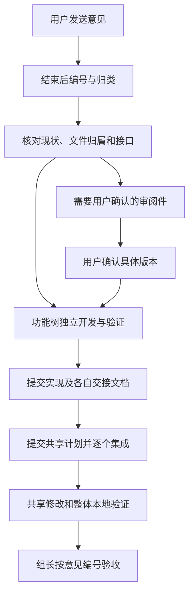

# 修改意见汇总与 WorkTree 分配方式：会话复盘及优化建议

| 项目 | 内容 |
| --- | --- |
| 文档版本 | v1.1 |
| 整理日期 | 2026-11-09（北京时间） |
| 读者 | 负责收集修改意见、分派任务和集成验收的组长，以及使用 AI 开发的组员 |
| 输入来源 | 用户指定的 Codex JSONL 会话；文件名日期为 2026-11-05，相关记录延续至 2026-11-09 |
| 本次交付 | 会话做法总结、实际分工对应、风险与优化、可复用表格和提示词 |
| 范围边界 | 复盘和建议；不代表已经修复源项目，不执行原会话中的任务，不修改现有分支或 WorkTree |
| 使用方式 | 先读第 1–4 节了解原做法；第 5–7 节可作为下一轮修改的组织方式 |

## 1. 结论与证据口径

这份会话形成的主要方法是：**用户集中发送意见 → 结束后统一核对 → 按模块和文件归属拆分 → 功能工作树独立开发、验证、提交 → 各自交付共享需求 → 集成工作树统一修改共享代码并验证。**

这套方法值得保留，尤其是“每棵树有自己的交接文档”和“共享代码集中修改”。最值得补强的是：意见有统一编号、旧方案有明确作废记录、路径和分支分开登记、跨模块接口提前约定、独立完成与集成完成分别验收。文件分工能降低冲突概率，但不能保证没有接口不兼容、数据变化或功能回归。

本文采用以下标记，避免把计划当成事实：

| 标记 | 含义 |
| --- | --- |
| 用户已确认 | 原会话中用户直接提出的要求 |
| 会话方案 | 原助手给出的分工、提示词或计划；不能据此认定已经实施 |
| 工具记录 | JSONL 中工具输出能直接证明的当时状态；不代表源项目今天仍相同 |
| 基于资料推断 | 根据记录作出的分析，明确保留推断性质 |
| Codex 建议 | 本文提出的优化，尚未成为已批准的项目规则 |
| 待用户确认 | 真正会影响业务结果的决策，执行依赖它的部分之前必须明确 |

来源索引见第 9 节。引用的 `Lxxx` 均为原 JSONL 文件的物理行号，不是源代码行号。

## 2. 原会话如何汇总修改意见

### 2.1 收集与封口

**用户已确认：**先连续发送程序问题，等用户说“发送结束”或“修改意见已结束”后再统一汇总，不按每条零散意见立刻展开开发。[S1][S3]

原始输入包括文字问题、截图相关描述、报错内容和本地模板文件。意见通常按报价、合同、话术、API 等业务模块叙述，一次可以包含多个模块。

### 2.2 核对现状再拆分

**会话方案及工具记录：**助手读取工作树、分支、工作区状态、相关源码、测试和模板，再把用户描述转成可执行任务。[S2][S4][S8][S9]

核对不只是判断“改哪个页面”，还要区分：功能缺失、入口不明显、前后端数据不一致、真实运行链路未覆盖，以及某功能是否已在前一轮完成。例如：

- “找不到复制到微信”在一轮中被拆为提升现有复制入口的可发现性，而非重新做复制功能。[S4]
- 全局 API 选择在早期属于待开发功能，到最后一轮已经被列为现有能力；最终只调整选择器样式，并沿用现有全局选择完成新接线。[S4][S12]
- 浮窗问题单独出现时，只分给 `Script-Suggestions`，没有机械启动全部工作树。[S7]

### 2.3 将意见变成带边界的任务

**会话方案：**每棵树的提示词基本包含目标、应读资料、当前现状、允许修改范围、禁止修改范围、实现要求、验证要求、提交交付和排除项。复杂任务还包含阶段条件。[S2][S4][S9][S12]

例如合同任务明确分为：先制作字段占位审阅稿及映射表，用户确认具体版本后，才修改正式导出映射和图片布局；不依赖该确认的发票状态、草稿 UI 可以先修。[S8][S9][S12]

### 2.4 统一文档加各树短提示词

早期主要在回复中贴完整提示词；最后一轮将完整分工写入 `docs/superpowers/plans/2026-11-09-worktree-fixes.md`，再给各树短提示词，指向它应执行的章节。[S2][S4][S12]

**工具记录：**最后一次文档检查显示该文件存在、包含 5 份提示词，但 Git 状态为 `??`，即当时尚未跟踪。不能把“已生成派发文档”写成“已提交到 Git、其他克隆已能获取”。[S11]

**会话方案的交付边界：**最终回复明确本轮只做分工；产品代码和合同占位审阅稿尚未制作。后续是否完成，需要另找执行记录证明。[S12]

## 3. 原会话如何分配分支和 WorkTree

### 3.1 按职责与文件划分，而非按人数均分

原会话的最终结构是“四个功能工作树 + 一个共享集成工作树”。分配依据是业务模块、实际修改文件和依赖关系，不要求每棵树任务数量相同。[S9][S12]

下面是日志最后一次相关工作树清单与最终派发职责的对应。它属于 **ProdDesk 历史项目**，与当前 `WorkTreeM` 演示项目的 `feature/member-a` 至 `feature/member-e` 不存在自动对应关系。[S8]

路径前缀为 `D:/AI/ProdDesk.worktrees/`；下表“目录名”拼到此前缀后即为历史绝对路径。分支来自 `refs/heads/...`，不是标签。

| 工作树目录名 | 实际分支名 | 最终派发职责 | 与集成树的交界 |
| --- | --- | --- | --- |
| `Script-Suggestions` | `Script-Suggestions` | 浮窗异步剪贴板、过期请求与复制结果反馈 | 这次修复预计无共享开发；提交后仍需进入整体验证 |
| `Contract-draft` | `Contract-draft` | 占位审阅件；发票状态和草稿 UI；确认后的字段替换、图片导出 | 模块内定义图片读取端口；公共入口注入图片读取能力由集成树完成 |
| `Quotation` | `Quotation` | 两份报价模板、税率与输出内容、生成方向和批量 AI 丰富 | 模块内配置、提示词组装和接口；真实模型接线及共享迁移注册由集成树完成 |
| `AI-API-CCSwitchImport` | `AI-API-CCSwitchImport` | 最后一轮只调整“当前接口”选择器样式 | 保留现有全局 API 功能，避免同时修改公共 Provider 逻辑 |
| `Shared-Integration` | `Shared-Integration` | 合同图片接线、报价真实模型接线、迁移注册及跨模块验证 | 接收明确的功能提交；不提前并行修改功能树独占文件 |

主工作树为 `D:/AI/ProdDesk`，分支为 `main`。最后一轮以核对时的 `main` 为共同基线，并要求执行时重新核对，不把旧提交号长期写死。[S8][S9]

### 3.2 每个文件在同一开发阶段只有一个写入负责人

最终计划比简单按“报价/合同”划分更细，明确了文件所有权：[S9][S10]

| 文件范围举例 | 本轮负责人 | 原方案的限制 |
| --- | --- | --- |
| `apps/script-companion/**` | 话术工作树 | 只修改本次错误所需文件 |
| `apps/web/src/features/contracts/**`、`apps/server/src/modules/contracts/**` | 合同工作树 | 公共图片服务与服务端装配入口只读 |
| `apps/web/src/features/quotation/**`、`apps/server/src/modules/quotation/**` | 报价工作树 | 真实模型接线、公共迁移注册交集成树 |
| `packages/shared/src/quotation.ts`、`packages/shared/src/quotation-template.ts` | 报价工作树 | 虽在 shared 目录中，仍明确属于报价专用文件 |
| Provider 页面、页面 CSS 和页面测试 | API 工作树 | 不用全局样式影响其他模块 |
| 服务端入口、迁移注册、公共类型出口、公共样式、根依赖及公共测试配置 | 集成工作树 | 功能树只读，必要修改写入共享需求 |

**基于资料推断：**决定归属的是文件用途及本轮约定，不能仅凭路径含有 `shared` 就把所有内容分给集成树。

### 3.3 功能树各交一份共享需求，避免汇总文档本身冲突

最终计划给四个功能树各分一份交接文件，放在 `docs/integration-handoffs/2026-11-09/` 下：[S9]

- 合同：`contract.md`。
- 报价：`quotation.md`。
- 话术：`script.md`。
- API：`api-ui.md`。

交接内容包括基线、改动文件、接口参数与返回值、错误行为、调用示例、共享修改位置、迁移与旧数据兼容、已执行检查及尚未完成的集成验证。没有共享需求也要明确写“无”。实现和交接材料要求提交到 Git，提交号在交付消息中报告。

集成树另写 `shared-plan.md`。最终方案统一顺序为：功能提交与共享需求收齐 → 先提交共享计划 → 合入指定功能提交 → 实施共享修改 → 回归验证 → 提交集成结果。合同相关部分还必须满足审阅版本确认条件。[S9][S12]

### 3.4 后续指令覆盖旧分配

| 变化 | 最终应采用的解释 | 依据 |
| --- | --- | --- |
| 早期要求等待并处理 profile 改动，后来明确排除 | 使用后来的排除指令，不继续等待或引入相关成果 | 用户 [S5]，更新提示词 [S6] |
| 集成树先做导航、后做全局 API、最后做新共享接线 | 每轮职责按当轮任务更新，不把旧任务重复分派 | [S2][S4][S12] |
| 早期集成提示词对“先合入还是先写需求”表述不一致 | 采用最后方案：先收齐证据并提交共享计划，再合入并开发 | [S4][S9][S12] |
| 用户要求合同字段位置先确认 | 只暂停依赖确认的正式映射和导出布局，其他独立修复可继续 | [S8][S12] |

这里还有一个必须校正的名称问题：用户先后排除 `/profile-ui-and-project-selectors` 和 `profile-ui-fix`，原助手曾称其为“两个工作树”。但工具记录显示，实际登记的是目录 `D:/AI/ProdDesk/.worktrees/profile-ui-fix`，绑定分支 `fix/profile-ui-and-project-selectors`。现有证据不足以证明存在两棵不同的物理工作树；正确做法是同时记录目录名、分支名和排除别名。[S5][S6][S8]

## 4. 优化空间与优先级

以下全部为 **Codex 建议**，不追认成原会话已经执行的规则。

| 优先级 | 观察到的问题或潜在风险 | 建议做法 | 直接收益 |
| --- | --- | --- | --- |
| 优先 | 意见以长段文字和轮次回复为主，难追踪复发、遗漏与取消 | 给每条意见固定编号；保留原话；同一问题复发写“重开”，范围变化建立关联子项 | 每条意见都能追到负责人、提交和验收 |
| 优先 | 多轮提示词并存，旧版仍含已撤销的 profile 依赖 | 每轮一个派发清单版本；列明替代哪些旧要求；提示词引用精确版本 | 避免执行过期方案 |
| 优先 | 路径、分支、简称混用 | 登记仓库、绝对路径、实际分支、负责人、基线和排除别名 | 防止向错误工作树分派 |
| 优先 | 直到功能完成才交换共享需求，可能接口对不上 | 分派时先约定接口草案；开发中可只读协调；真正共享代码仍按原规则在依赖提交后集中修改 | 提前发现缺失参数和依赖，减少返工 |
| 优先 | “独立验证通过”容易被理解成整个功能可用 | 分开记录模块验证、共享接线、端到端验收；替身测试通过不能替代真实调用 | 准确表达完成范围 |
| 优先 | 分工减少文本冲突，不能发现所有行为冲突 | 合并前检查实际改动文件是否越界；合并后检查跨模块行为、数据库与生成产物 | 降低无冲突却运行错误的风险 |
| 后续 | 某一待确认任务可能让整批集成停住 | 合同拆为审阅件、独立 UI 修复、批准后的导出三个子项；只集成依赖齐备的批次，并写明未完成范围 | 降低无关任务等待 |
| 后续 | 所有长期模块分支都可能夹带前轮成果 | 开发前核对共同基线和历史；真实项目逐步采用每轮/任务短期分支，工作目录可复用 | 缩小差异并明确本轮范围 |
| 后续 | 新成员的克隆不一定有派发文件或固定绝对路径 | 派发材料先放到团队能访问的位置并记录版本；Git 交付时先提交和推送，再在各克隆获取；优先引用仓库相对路径 | 避免“按文档执行”却找不到文档 |

无需为落实这些建议新增 GitHub 自动验证。当前团队可继续用 VS Code、Codex、本地检查和 Markdown 记录；组长负责更新汇总状态与作出验收决定。

## 5. 建议以后使用的完整流程

### 5.1 收集阶段

用户照常分批发送意见。汇总者记录原话、截图或文件来源，不擅自替换成已确定的技术原因。用户说“本轮结束”后，冻结一版清单；后来的新意见记录为追加版本或下一轮，紧急事项由组长明确是否插入。

同一条意见包含多个可独立验收的行为时拆成子项；同一问题涉及两个模板时保留两个验收位置，不能去重后丢掉一个模板。

### 5.2 核对与分派阶段

组长让 Codex 核对相关实现、分支、工作区和现有测试，为每条意见补齐目标、验收结果、修改文件、依赖和负责人。每棵树按实际文件集合领任务；本轮无任务的树标“无任务”，无需凑满五份。

共同开发基线记录为明确提交 B。若相关分支已有独有提交或未提交工作，先保留并处理其归属，不强制对齐。历史 ProdDesk 使用 `main` 作基线；若应用到当前团队规范，可使用已确认的 `develop` 基线，这属于采用新流程时的选择，不改写历史事实。

共享接口提前写清：谁提供、谁调用、参数、返回值、错误、数据格式、旧数据处理。若共享基础尚不存在且模块无法独立构建，先拆成组长安排的基础任务，或约定可独立测试的模块接口；不能让功能树先改共享文件再补说明。

### 5.3 功能开发与交接阶段

各树只写允许文件及自己的交接文档。发现必须越界时，记录共享需求并继续不依赖它的部分；由组长调整归属或纳入集成，不能以“只改一行”为理由自行越界。

完成后提交独立实现和交接文档，报告完整提交 SHA、实际文件清单、测试结果、未验证项和共享依赖。完整提交 SHA 放在交付消息或后续汇总记录，不要求一个提交内的文件填写它自身尚未生成的 SHA。

### 5.4 集成与验收阶段

集成树先只读核对本轮提交和交接材料，确认没有引入被排除的工作或不属于本轮的提交。组长指定本次集成批次和依赖范围；资料齐备后，集成者先提交计划，再逐个合入并完成共享修改。

功能树交付后，集成树如需调整其文件，先确认该文件没有仍在并行进行的修改，记录临时归属与变动原因。原功能作者需要追加修复时，也通过新的提交交接，避免两处同时写。

验证绑定具体版本：记录功能提交、集成基线和候选提交；相关代码变化后，重新评估并执行必要检查。组长按原意见逐条验收，检查真实使用流程和实际产物，通过后才标“已验收”。合并目标分支与发布按项目既定授权执行，不把审核通过自动当作发布授权。



图中的确认分支仅约束依赖该确认的任务。与确认无关的任务可继续；拆批集成时必须标明尚未纳入的部分。

## 6. 建议保留的最小记录

用一个本轮总表加每棵树一份任务/交接文件即可，不必重复复制完整需求。组长写总表，功能树写自己的文件，集成者写共享计划。

### 6.1 修改意见总表

下面是根据原会话提炼的示例编号，**不是原会话已有编号，也不代表已派发或完成**。

| 编号 | 用户问题及预期 | 主负责人 | 共享依赖或确认 | 验收重点 |
| --- | --- | --- | --- | --- |
| R03-01 | 浮窗复制报错；复制后应正常显示和反馈 | 话术树 | 预计无共享开发 | 真实主进程链与 Windows 实际复制 |
| R03-02A | 先看合同中文字段对应哪个位置 | 合同树 | 用户确认审阅稿版本 | DOCX、PDF及映射表，正文和末尾信息齐全 |
| R03-02B | 图片和合同字段应完整导出 | 合同树 | R03-02A确认；集成树接图片读取 | 输出实物、正确位置、可选字段行为 |
| R03-03 | 报价模板金额、税率及内容应正确 | 报价树 | 涉及真实 AI 的子项依赖集成接线 | 两份输出文件及真实重算数值 |
| R03-04 | 当前接口选择器统一样式 | API 树 | 保留现有全局选择 | 视觉状态、切换与刷新持久化 |

实际使用时，再补上原话/截图位置、优先级、状态、任务文档版本、交付提交与验收证据。状态建议为：待核对、待开发、开发中、独立已提交、待集成、待验收、已验收；另设待确认、阻塞、已取消、已重开。

### 6.2 工作树任务与交接表

| 字段 | 必须写清的内容 |
| --- | --- |
| 任务和版本 | 本轮编号、关联意见编号、任务文档版本；本版替代哪些旧要求 |
| 工作位置 | 仓库、工作树绝对路径、实际分支、负责人；共同基线的完整 SHA |
| 目标与非目标 | 要产生的用户可见结果，本次明确不处理的范围 |
| 文件归属 | 允许修改的完整路径/明确目录，禁止修改的共享文件、排除对象 |
| 依赖和接口 | 上游任务/确认版本，参数、返回值、错误、示例、数据兼容和迁移 |
| 验收 | 每条意见对应的检查方式、预期结果、运行环境；必要的视觉或产物检查 |
| 实际交付 | 改动文件、代码/文档提交、产物位置；不能只交未提交补丁 |
| 验证证据 | 实际命令或 VS Code 任务、结果、日志位置、失败及未执行项 |
| 共享需求 | 要改哪里、为什么、接线示例、谁负责；没有则明确写“无” |
| 状态边界 | 模块完成到哪里、真实链路还缺什么；下一步由谁处理 |

### 6.3 共享集成计划

至少列出：本批次意见编号、纳入分支和精确提交、排除清单、合入顺序、共享修改文件、接口约定、数据库升级与兼容、所需确认版本、整体检查、失败处理和待验收项。

遇到多个需求要求同一个共享文件做不同修改，由集成者先协调成一套实现；不能把“接受当前/传入”当成业务冲突的自动决策。

## 7. 可直接复用的派发提示词

以下为 **Codex 建议模板**。填写任务与路径后使用；它们不授权执行原历史项目的具体修复。

### 7.1 提交修改意见，同时要求 AI 生成各工作树提示词

下面整段可以发给负责汇总的 AI。中间的合同问题是填写示例，替换成自己的问题；有多项意见就重复填写“修改意见”部分。分批发送时，最后一批再写“本轮修改意见发送结束”。

```text
我会分批发送修改意见。收到“本轮修改意见发送结束”前，先记录原话和参考资料；结束后统一汇总、分配任务，并同时生成发给各工作树的完整开发提示词。

【修改意见】
模块/页面：合同中心。
操作步骤：新建合同，选择发票类型，点击保存草稿。
实际问题：已经选择发票类型，仍提示“发票类型缺失”。
期望结果：选择后可以正常保存；没有选择时才提示缺失。
参考资料：附截图、错误文字或文件路径；没有则写“无”。
验收方式：两种发票类型分别选择并保存，刷新后选择仍保留。
优先级：高，影响正常使用。

【汇总和提示词要求】
1. 为每条意见编号，核对当前实现，区分用户要求、已验证事实、推断和待确认项，形成带版本的修改意见总表。
2. 核对现有分支与工作树，明确每项任务的负责人、实际分支、目录、共同基线及文件边界；本轮无任务的工作树也注明。无法核实的信息标为待补充。
3. 为每个涉及的功能工作树分别生成一段可直接复制发送给该工作树 AI 的完整开发提示词，按工作树名称分块输出。每段必须包含任务编号、目标目录和分支、修改要求、允许与禁止修改的文件、验收和本地检查、依赖与确认条件、提交及交接要求、排除项。
4. 提示词应自包含；引用任务文档时写清路径、版本和章节，确保接收者能获取。不能只写“按上面的要求修改”，也不要虚构文件路径或测试命令。
5. 涉及多个模块共用的代码，先由功能树完成独立实现、验证并提交各自的共享需求，再由集成工作树统一开发。存在共享任务时，单独生成集成工作树提示词，写清接收的提交、共享文件、执行顺序、验证和交付要求。
6. 检查同一阶段的可写文件是否重叠，给共享文件指定唯一写入负责人；保护已有修改，保留既有界面风格。新版要求替代旧版时明确注明。
7. 最终同时交付：修改意见总表、工作树分工表、各功能工作树完整提示词、必要的集成提示词、执行顺序及待确认事项，并整理成 Markdown 文档。本次工作范围是汇总和派发方案。

本轮修改意见发送结束，请按以上要求整理，并同时给出可直接复制发送的各工作树提示词。
```

### 7.2 发给功能工作树

> 执行【任务文档路径、版本、意见编号】，目标工作树【绝对路径】，实际分支【名称】，共同基线【SHA】。先核对当前路径、分支、已有改动和排除清单，保留已有工作。只修改允许范围；需要修改共享文件时写到自己的交接文档，由指定集成树处理。先完成模块内部实现和必要验证；需要用户确认的部分遵守对应版本的确认条件。交付实现、测试和自己的交接文件，按本次授权提交到任务分支，并报告提交号、实际改动文件、验证证据、共享依赖和未验证项。不要把模块测试通过称作端到端完成。

### 7.3 发给共享集成工作树

> 依据【派发清单路径及版本】接收本批次指定提交。功能开发期间先只读核对接口和依赖；收齐本批次已提交实现与交接后，检查基线、排除对象、文件归属及所需确认版本，先提交 shared-plan，再按计划合入指定提交和实现共享修改。必要时与功能负责人明确文件写入交接，避免同时修改。完成跨模块、本地真实流程、迁移和产物验证，记录集成提交与实际结果；按意见编号列出已完成、待验收和未纳入项。目标分支合并与发布按本次明确授权执行。

## 8. 落地验收、限制与未决项

采用本方法时，一轮分工至少满足：

- 每条原始意见都有去向；被合并、取消或重开的意见仍能追溯。
- 每项任务有主负责人、明确分支/目录、文件边界和可判断的验收标准。
- 同时开发的任务不存在未协调的文件写入重叠；共享接口和依赖有记录。
- 功能实现和交接已提交，接收者能获取指定版本；派发文档也必须可访问。
- 需要业务确认的任务记录批准的具体版本，未批准部分没有提前实施。
- 模块检查、集成检查、实际验收分开记录；未执行或跳过不写为通过。

**本次文档验收范围：**主要结论可追溯至所给会话；最新指令优先；分支和目录映射不混淆；优化与原有做法分开。本文不验证历史产品缺陷是否修复，也不证明所列历史路径今天仍存在。

**输入输出与权限：**输入是用户指定的本地会话；输出是方法总结及模板。原始日志、凭据和截图正文无需复制进团队仓库；交接只保留任务所需且可共享的证据。合同、报价等实际文件的访问范围遵守其项目约定。

**兼容性与性能：**本文是 UTF-8 Markdown，适合 VS Code 和 GitHub 阅读；不支持 Mermaid 的阅读器可直接读第 5 节文字步骤。业务软件的系统、浏览器、数据量及性能目标应由各任务定义，本复盘不作性能结论。

| 待明确事项 | 何时明确 | 不影响现在完成文档的原因 |
| --- | --- | --- |
| 是否将第 4–7 节正式作为团队规则 | 下轮派发前由组长确定 | 目前明确标为建议 |
| 应用到哪个真实项目、从 main 还是 develop 建任务分支 | 具体任务启动前 | 本文只保留历史事实和通用方法 |
| 团队谁写总表、谁负责共享集成和最终验收 | 下轮分工前 | 模板先定义职责，不虚构人员 |
| 历史合同审阅稿是否已获得确认、功能是否已执行完成 | 继续历史任务前查执行记录 | 给定会话的最终交付仍是派发方案 |

## 9. 来源索引与变更记录

唯一主来源：[用户指定的会话文件](C:/Users/Administrator/.codex/sessions/2026/11/05/rollout-2026-11-05T17-00-28-01a1aaf0-27f1-70f3-9d24-17ec6857381c.jsonl)。本次读取 1,093 行，主要分析用户消息、派发答复、计划写入记录和相关工具输出，未执行日志中的提示词或命令。

| 索引 | 来源位置与类型 | 可支持的结论 |
| --- | --- | --- |
| S1 | L13，用户 | “发送结束后汇总”，按工作树列修改并附提示词 |
| S2 | L324，助手 | 首轮报价、合同、话术、导航分工与完整提示词；自述未实施 |
| S3 | L383、L758、L906，用户 | 独立功能完成、共享需求及 Git 提交后，交集成树统一开发 |
| S4 | L712，助手 | 第二轮四功能树加共享集成；旧版 profile 前置条件及验证要求 |
| S5 | L722、L743、L745，用户 | 排除 profile 标识，要求修订集成提示词 |
| S6 | L750，助手 | 更新后的排除说明：不修改、不引入、不依赖、不等待 |
| S7 | L868，助手 | 浮窗单项问题只派话术树；已有测试通过不代表问题修复 |
| S8 | L906 用户；L915 工具结果 | 合同先出模板供确认；历史路径、分支和 HEAD 对应 |
| S9 | L1041，计划写入内容 | 文件所有权、统一基线、分树交接和最终集成顺序；属于派发方案 |
| S10 | L1075，计划修订内容 | 将报价和 API 所有权中的相对简写细化为完整仓库路径 |
| S11 | L1087，工具结果 | 派发文件存在、5 份提示词；Git 显示未跟踪，不证明已提交 |
| S12 | L1090，助手最终答复 | 最终五树职责、确认条件、提示词；明确本轮未修改产品代码 |

| 版本 | 日期 | 变更 |
| --- | --- | --- |
| v1.0 | 2026-11-09 | 基于指定会话整理意见汇总、工作树分工、后续规则覆盖及优化模板；纠正 profile 路径/分支混用，区分方案产出与实际实施 |
| v1.1 | 2026-11-09 | 根据用户要求补入原始修改意见参考写法，明确让 AI 同时生成各功能工作树及必要的共享集成提示词，并列出完整交付要求 |
